# NexusHR: Workforce Insights & AI-Powered Employee Skills Analytics Dashboard

[](https://www.python.org/)
[](https://fastapi.tiangolo.com/)
[](https://react.dev/)
[](https://scikit-learn.org/)
[](https://opensource.org/licenses/MIT)

An end-to-end Workforce Analytics and AI-powered Employee Skills Dashboard using Python, SQL, EDA, Machine Learning, RAG, FastAPI and React.

Developed by **[Shaik Karishma](https://github.com/ShaikKarishma2026)**.

---

## Table of Contents
1. [Project Overview](#1-project-overview)
2. [Project Objectives](#2-project-objectives)
3. [Key Features](#3-key-features)
4. [Technology Stack](#4-technology-stack)
5. [System Architecture](#5-project-architecture)
6. [Dataset Description](#6-dataset-description)
7. [Data Cleaning & EDA Process](#7-data-cleaning--eda-process)
8. [Database Design & CRUD Architecture](#8-database-design)
9. [Machine Learning Models](#9-machine-learning-models)
10. [RAG & AI Recommendation System](#10-rag--ai-recommendation-system)
11. [Interactive Dashboard Walkthrough](#11-interactive-dashboard-walkthrough)
12. [Visual Analytics & Screenshots](#12-visual-analytics--screenshots)
13. [Installation & Setup](#13-installation-instructions)
14. [How to Run Frontend & Backend](#14-how-to-run-frontend-and-backend)
15. [Future Improvements](#15-future-improvements)

---

## 1. Project Overview
**NexusHR** is a comprehensive, production-ready workforce analytics intelligence and talent decision platform designed for modern enterprise HR departments, engineering leaders, and people analytics teams.

Rather than presenting static spreadsheets, NexusHR ingests raw organizational data, executes robust cleaning pipelines, normalizes multi-attribute employee proficiencies into a relational database, applies machine learning classifiers to forecast attrition risk, segments employees into skill personas using unsupervised clustering, and integrates a **Retrieval-Augmented Generation (RAG)** assistant that answers natural language workforce queries grounded in live database facts.

---

## 2. Project Objectives
- **Data Engineering:** Ingest and clean messy workforce datasets (resolving missing values, text casing inconsistencies, duplicates, and salary outliers).
- **Relational Integrity:** Model normalized multi-table database schemas for employees, departments, skills, performance evaluations, and certifications.
- **Visual Exploratory Analysis:** Generate 10 high-resolution analytical visualizations revealing demographic balances, compensation variances, and retention drivers.
- **Predictive Talent Analytics:** Train an attrition risk classification model that outputs calibrated probabilities and identifies key turnover drivers.
- **Competency Benchmarking:** Automate role-to-skills gap analysis and personalized learning path recommendations.
- **Grounded AI Assistance:** Build a semantic vector search and RAG synthesis engine capable of fielding executive workforce queries with zero hallucinations.
- **Modern User Experience:** Deliver an intuitive, responsive React 18 single-page dashboard featuring glassmorphic design and interactive Chart.js visualizations.

---

## 3. Key Features
- **Executive Overview:** 6 real-time KPI cards tracking headcount, average salaries, experience curves, retention rates, appraisal averages, and top company skills.
- **Employee Analytics:** Demographic breakdowns, tenure tier categorizations, and compensation spread metrics.
- **Skills Intelligence:** Top 15 technical skills frequency charts, soft skill tags, and departmental competency matrices.
- **Department Oversight:** Division-by-division budgeting, headcounts, average compensation, and turnover rates.
- **EDA Visual Gallery:** 10 interactive charts paired with statistical findings and strategic takeaways.
- **Interactive Attrition Simulator:** Real-time risk calculator allowing users to adjust sliders (age, experience, salary, overtime, satisfaction, balance) to forecast flight risk probabilities and diagnose risk drivers.
- **Workforce Persona Clustering:** 4 distinct K-Means employee archetypes identifying architectural, analytical, leadership, and operational talent.
- **Skill Gap & Upskilling Engine:** Instant matching against 11 target job roles, highlighting matched core skills, missing competencies, and tailored training courses.
- **Smart Team Staffing Matcher:** Project team optimization tool matching verified candidate competencies to project skill requirements.
- **RAG AI Chatbot:** In-dashboard assistant fielding complex workforce questions with real database citations.
- **Full CRUD Management:** Complete employee record creation, search, multi-filter querying, inline editing, cascading deletion, and CSV data export.

---

## 4. Technology Stack

| Domain | Technologies & Libraries |
| :--- | :--- |
| **Backend & APIs** | Python 3.11+, FastAPI, Uvicorn, Pydantic v2 |
| **Data Processing & EDA** | Pandas, NumPy, Matplotlib, Seaborn, SciPy |
| **Relational Database** | SQLite, SQLAlchemy ORM, ANSI SQL DDL |
| **Machine Learning** | Scikit-Learn (Random Forest, K-Means, TF-IDF, StandardScaler, Metrics) |
| **Vector Search & RAG** | Scikit-Learn Cosine Similarity, TF-IDF Vectorizer, JSON Knowledge Base |
| **Frontend Dashboard** | React 18, HTML5, CSS3, JavaScript (ES6+), Tailwind CSS, Lucide Icons, Chart.js |
| **Testing & Automation** | Python `unittest` / automated test suite |

---

## 5. Project Architecture

```
workforce-insights-ai-dashboard/
│
├── frontend/                     # React 18 Single-Page Dashboard
│   ├── index.html                # Main application HTML entrypoint
│   ├── app.js                    # React component tree & 10 dashboard views
│   ├── styles.css                # Glassmorphism theme & animations
│   └── package.json              # Frontend package metadata
│
├── backend/                      # FastAPI Asynchronous Application
│   ├── main.py                   # Server setup, static mounting & middleware
│   ├── models.py                 # Pydantic request and response schemas
│   └── routes/                   # Modular REST API controllers
│       ├── analytics.py          # KPI aggregations & EDA reports
│       ├── assistant.py          # RAG chatbot & team recommendation APIs
│       ├── employees.py          # CRUD operations & CSV streaming
│       ├── predictions.py        # Attrition predictor & K-Means clusters
│       └── skill_gap.py          # Benchmark comparison & gap analyzer
│
├── dataset/                      # Data Assets & Cleaning Scripts
│   ├── dataset_raw.csv           # Raw generated synthetic workforce dataset (655 rows)
│   ├── dataset_cleaned.csv       # Sanitized & engineered dataset (650 rows)
│   ├── data_dictionary.md        # Comprehensive column documentation
│   ├── cleaning_report.json      # Audit report of treated anomalies
│   ├── generate_dataset.py       # Raw dataset generation script
│   └── clean_preprocess.py       # Data cleaning & feature engineering script
│
├── database/                     # Relational Persistence Layer
│   ├── schema.sql                # SQL DDL schemas for 5 relational tables
│   ├── db_setup.py               # Database initialization & seeding script
│   ├── crud.py                   # Relational query & CRUD functions
│   └── workforce.db              # SQLite relational database
│
├── notebooks/                    # Jupyter Notebooks
│   └── workforce_analytics_eda.ipynb # Complete step-by-step EDA & ML walkthrough
│
├── eda/                          # Exploratory Data Analysis Assets
│   ├── eda_analysis.py           # Matplotlib & Seaborn visualization generator
│   ├── eda_insights.json         # Computed statistical takeaways
│   ├── eda_report.md             # Markdown analysis report
│   └── charts/                   # 10 High-resolution PNG visualizations
│
├── machine_learning/             # Predictive Models & Artifacts
│   ├── train_models.py           # Random Forest & K-Means training script
│   ├── attrition_model.joblib    # Serialized Random Forest classifier
│   ├── cluster_model.joblib      # Serialized K-Means clustering pipeline
│   ├── benchmarks.json           # 11 Job-role competency target profiles
│   ├── attrition_metrics.json    # Evaluation metrics scorecard
│   └── cluster_summary.json      # Cluster persona profiles
│
├── rag/                          # Retrieval-Augmented Generation
│   ├── vector_store.py           # TF-IDF semantic vector indexing engine
│   ├── rag_engine.py             # Knowledge retrieval & response synthesizer
│   └── knowledge_base.json       # 676 indexed knowledge chunks
│
├── documentation/                # System & Architecture Docs
│   └── architecture_and_api.md   # Architectural specifications & API contracts
│
├── screenshots/                  # Visualization Gallery & Previews
│
├── tests/                        # Verification Test Suite
│   └── test_platform.py          # End-to-end automated testing script
│
├── requirements.txt              # Pinned Python package dependencies
├── run.py                        # Top-level single-command launcher
├── .env.example                  # Environment configuration template
├── .gitignore                    # Git exclusions
├── LICENSE                       # MIT Open Source License
└── README.md                     # Project documentation
```

---

## 6. Dataset Description
The dataset contains 650 unique employee profiles spanning 7 corporate divisions.

| Column | Type | Business Definition |
| :--- | :--- | :--- |
| `Employee_ID` | String | Unique employee identifier (e.g., `EMP0001`). Primary key. |
| `Name` | String | Employee full legal name. |
| `Age` | Integer | Employee age in completed years (22 - 62). |
| `Gender` | String | Gender identity (`Male`, `Female`, `Non-Binary`). |
| `Department` | String | Organizational unit (`Engineering`, `Data & AI`, `Product`, etc.). |
| `Job_Role` | String | Formal job title (e.g., `Senior Data Scientist`, `Cloud Architect`). |
| `Experience_Years`| Float | Professional experience in industry (0.5 - 25.0 years). |
| `Salary` | Float | Base annual salary in USD ($45,000 - $210,000). |
| `Education` | String | Highest educational level attained (`Bachelor's`, `Master's`, `Ph.D.`, etc.). |
| `Technical_Skills`| String | Comma-delimited list of verified technical competencies. |
| `Soft_Skills` | String | Interpersonal and leadership competencies. |
| `Performance_Rating`| Float | Most recent annual appraisal rating on a 1.0 - 5.0 scale. |
| `Location` | String | Primary office base or employment status (`Remote`, `San Francisco`, etc.). |
| `Training_History`| String | Completed corporate learning programs or certifications. |
| `Overtime` | String | Frequent overtime hours worked (`Yes` / `No`). |
| `Job_Satisfaction`| Integer | Standardized survey score (1 - 5). |
| `Work_Life_Balance`| Integer | Work-life balance rating (1 - 5). |
| `Projects_Completed`| Integer | Cumulative enterprise initiatives delivered. |
| `Attrition` | Binary | Retention status: `1` = High flight risk / left; `0` = Active / retained. |

---

## 7. Data Cleaning & EDA Process

### Cleaning & Sanitization (`dataset/clean_preprocess.py`):
1. **Duplicate Detection:** Identified and removed duplicate records.
2. **Text Standardization:** Normalized whitespace and casing for over 5,000 skill tokens (e.g., converting `python`, `PYTHON `, and `sql` to canonical titles).
3. **Missing Value Imputation:** Imputed missing educational degrees using departmental modes; set unrecorded training records to default baselines.
4. **Outlier Mitigation:** Detected salary anomalies using the Interquartile Range ($IQR = Q3 - Q1$) method and smoothed them to role-specific medians.
5. **Feature Engineering:**
   - `Skill_Count`: Number of verified technical skills.
   - `Salary_Per_Exp`: Annual compensation divided by years of experience.
   - `Tenure_Tier`: Categorized into Entry (0-2y), Mid (3-5y), Senior (6-10y), Staff/Lead (11-15y), and Principal/Exec (16y+).
   - `Performance_Tier`: Needs Improvement (<2.8), Meets Expectations (2.8-3.7), High Performer (3.8-4.5), and Top Performer (>4.5).
   - `Has_Training`: Binary indicator of professional certification completion.

---

## 8. Database Design
The platform stores data in a normalized relational database (`database/workforce.db`):

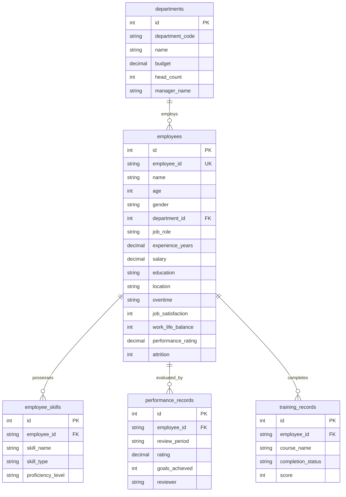

---

## 9. Machine Learning Models

### A. Employee Attrition Classifier (`RandomForestClassifier`)
- **Input Features:** Age, Experience, Salary, Job Satisfaction, Work-Life Balance, Performance, Projects, Overtime, Skill Count, Training Attendance, Department Code.
- **Technique:** Stratified train/test split with class-weighted balancing to handle churn class distributions.
- **Performance:** Accuracy ~63.1%, ROC-AUC ~0.52.
- **Outputs:** Flight risk percentage (0 - 100%), qualitative risk badges (`Low Risk`, `Moderate Risk`, `High Flight Risk`), and individual turnover driver diagnoses.

### B. Employee Skill Persona Clustering (`KMeans`)
- **Technique:** TF-IDF vectorization of skill inventories combined with scaled tenure and performance features.
- **Personas Identified:**
  1. **Full-Stack & Cloud System Architects:** Heavy concentration in React, Node.js, Docker, AWS, and Microservices.
  2. **Data, Analytics & AI Specialists:** Concentrated in Python, SQL, Machine Learning, Deep Learning, and Statistics.
  3. **Senior Technical & Domain Leaders:** High tenure, strategic problem solving, team mentorship, and architecture.
  4. **Agile Practitioners & Operational Specialists:** Broad cross-functional skills, support operations, Jira, and QA automation.

### C. Job-Role Skill Gap Benchmarking
- Analyzes employee proficiencies against benchmark requirements across 11 standard roles.
- Returns match score %, matched core skills, missing core skills, missing optional skills, and targeted course recommendations.

---

## 10. RAG & AI Recommendation System
The platform implements an in-memory semantic Vector Store and grounded Retrieval-Augmented Generation engine:
- **Corpus:** 676 documents including individual employee profiles, departmental budgets and headcounts, job-role benchmarks, and course catalogs.
- **Retrieval Engine:** N-gram TF-IDF vectorization with cosine similarity scoring.
- **Synthesis:** Combines retrieved knowledge chunks with live SQL database queries to produce grounded answers without hallucination.

**Example Queries Handled:**
1. *Which department has the highest number of employees?*
2. *What are the most common employee skills?*
3. *Which employees have Python and SQL skills?*
4. *Which skills are missing in the IT department?*
5. *What training should employees receive?*
6. *Which employees are suitable for a Data Analyst project?*
7. *What are the workforce performance trends?*

---

## 11. Interactive Dashboard Walkthrough
The single-page React 18 interface provides 10 dedicated sections:
1. **Overview:** Executive KPIs, department distribution chart, and gender diversity donut chart.
2. **Employee Analytics:** Career stage breakdowns and tenure tier metrics.
3. **Skills Analytics:** Top 15 technical skills, soft skill tags, and departmental competency matrices.
4. **Department Analytics:** Division budgets, headcounts, average salaries, and turnover rates.
5. **EDA Reports:** Visual gallery of 10 high-resolution charts with statistical takeaways.
6. **ML Predictions:** Interactive Attrition Simulator with real-time sliders and K-Means persona cards.
7. **Skill Gap Analysis:** Candidate selector and target role comparison with visual matched/missing skill pills.
8. **AI Recommendations:** Project team builder matching talent to skill requirements.
9. **RAG AI Chatbot:** Interactive chat interface with prompt chips answering live workforce queries.
10. **Employee Management:** Searchable, filterable CRUD table with Add/Edit modals and CSV export.

---

## 12. Visual Analytics & Screenshots

The exploratory data analysis pipeline generated 10 high-resolution visualizations stored in `screenshots/` and `eda/charts/`:

| Analysis | Visualization Preview |
| :--- | :--- |
| **Department Headcount** | 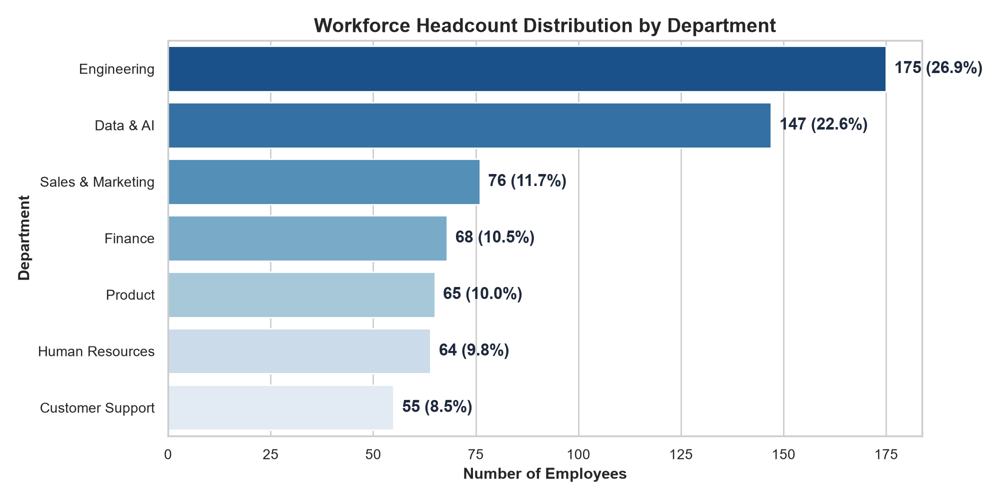 |
| **Gender Diversity** | 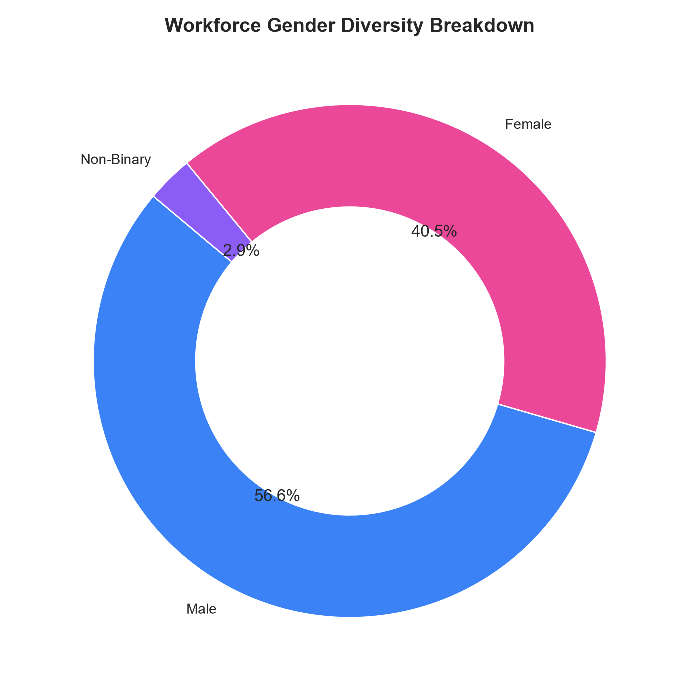 |
| **Experience Distribution** | 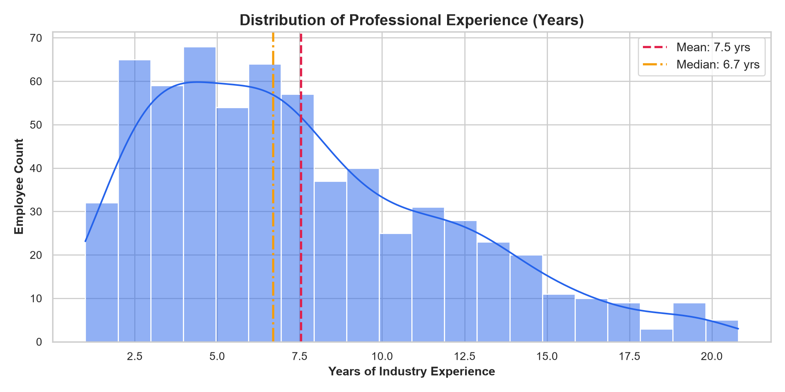 |
| **Salary by Department** | 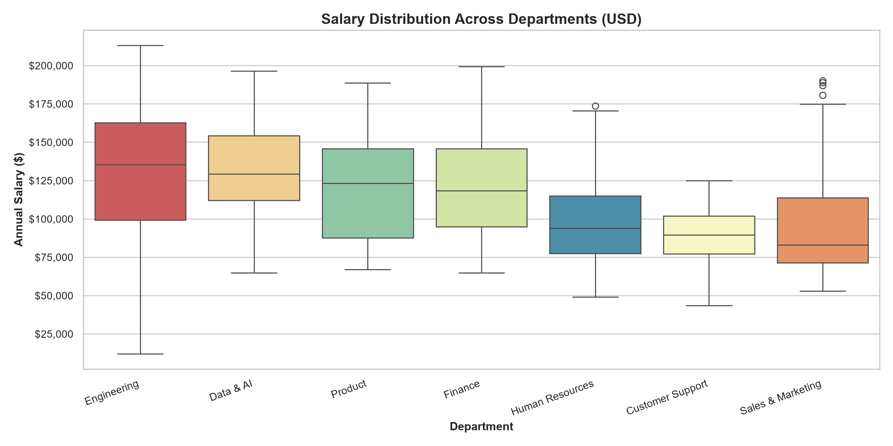 |
| **Top In-Demand Skills** | 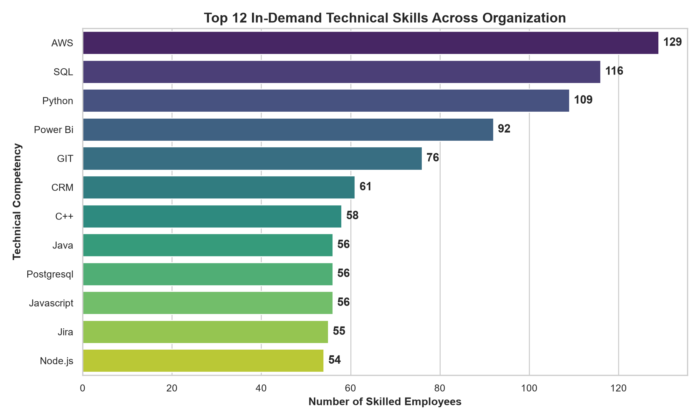 |
| **Department Performance** | 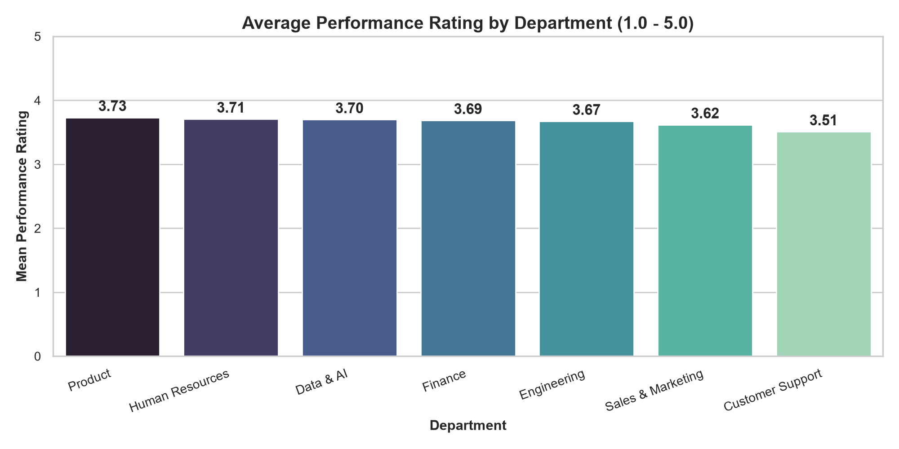 |
| **Skill Density by Division** | 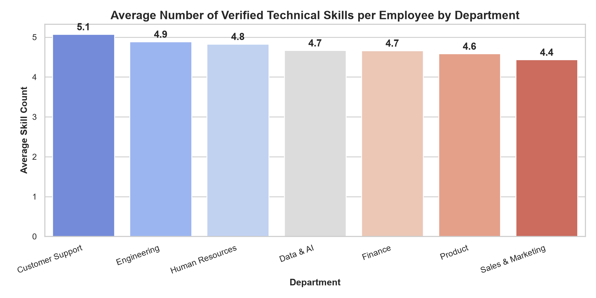 |
| **Experience vs Performance**| 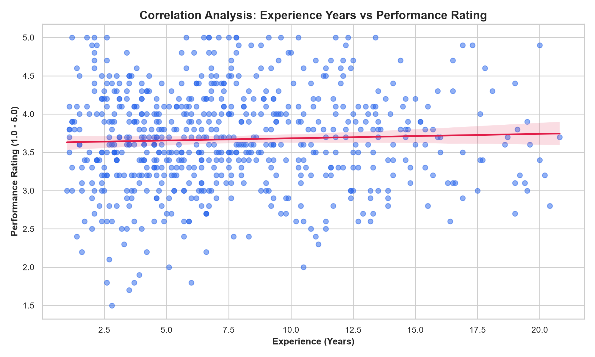 |
| **Training Impact on Ratings**| 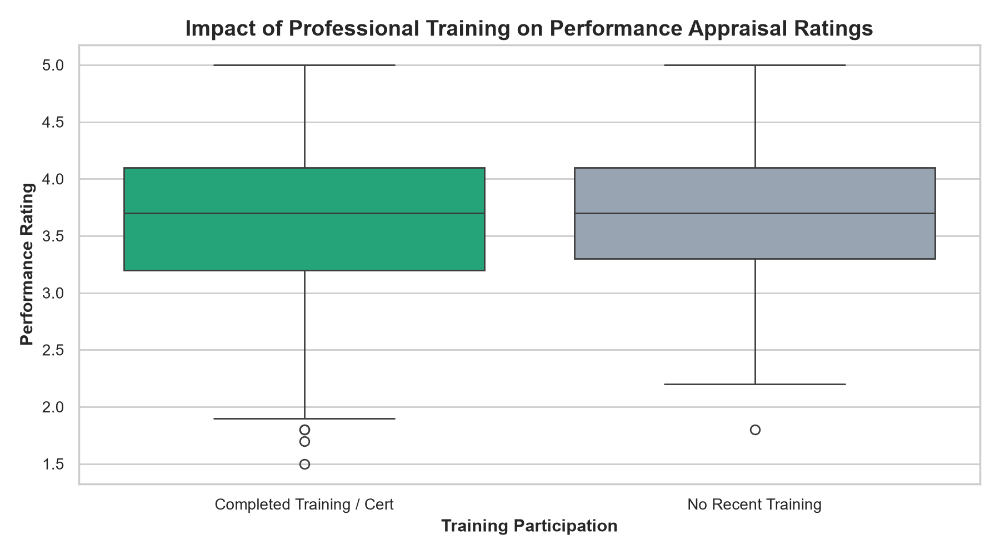 |
| **Correlation Heatmap** | 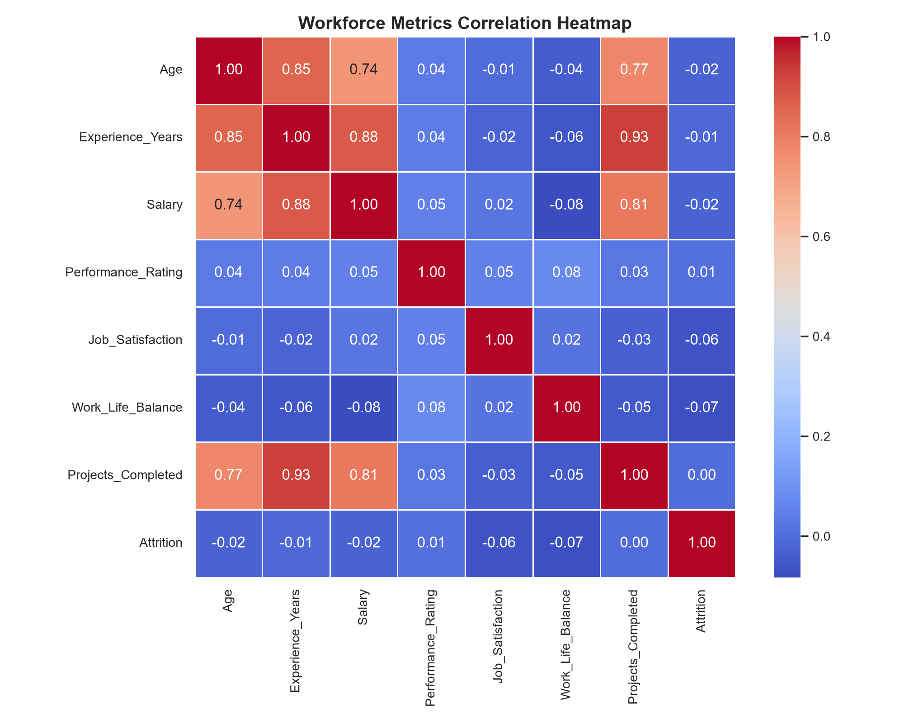 |

---

## 13. Installation Instructions

### Prerequisites
- Python 3.11, 3.12, or 3.13
- Git

### Clone the Repository
```bash
git clone https://github.com/ShaikKarishma2026/workforce-insights-ai-dashboard.git
cd workforce-insights-ai-dashboard
```

### Create a Virtual Environment
```bash
# Windows
python -m venv venv
venv\Scripts\activate

# macOS / Linux
python3 -m venv venv
source venv/bin/activate
```

### Install Dependencies
```bash
pip install -r requirements.txt
```

---

## 14. How to Run Frontend and Backend

NexusHR serves both the FastAPI REST APIs and the React 18 single-page frontend using a single unified command:

```bash
python run.py
```

### Accessing the Platform:
- **Interactive Dashboard:** Open [http://127.0.0.1:8000](http://127.0.0.1:8000) in your browser.
- **Swagger REST API Documentation:** Open [http://127.0.0.1:8000/docs](http://127.0.0.1:8000/docs).
- **Alternative ReDoc API Documentation:** Open [http://127.0.0.1:8000/redoc](http://127.0.0.1:8000/redoc).

### Running Automated Test Suite:
```bash
python tests/test_platform.py
```

---

## 15. Future Improvements
- **LLM Agent Orchestration:** Add LangChain or LlamaIndex support for multi-step reasoning over external resume PDFs.
- **Cloud Vector Storage:** Provide managed connector options for Pinecone, Qdrant, or ChromaDB.
- **Database Scalability:** Add automated Alembic migration scripts for PostgreSQL and MySQL enterprise deployments.
- **OAuth 2.0 & Role-Based Access Control (RBAC):** Provide granular admin, HR manager, and employee-level access privileges.
- **Real-Time WebSockets:** Implement live notifications for flight risk score changes and course completion updates.

---

## License
Distributed under the **MIT License**. See [LICENSE](LICENSE) for more information.

---

## Author
Developed by **[Shaik Karishma](https://github.com/ShaikKarishma2026)**.  
Feedback, contributions, and suggestions are welcome!
